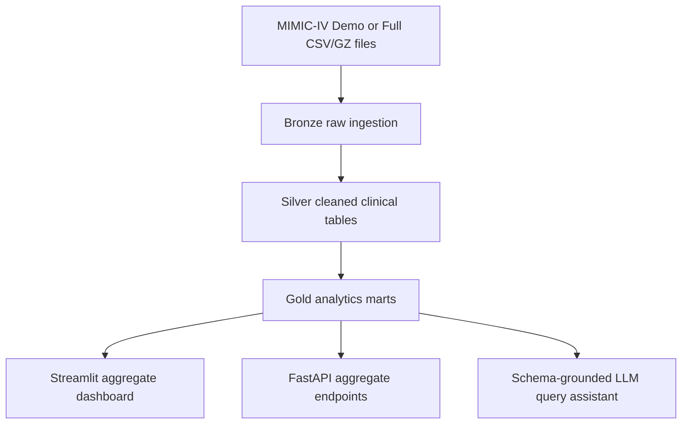
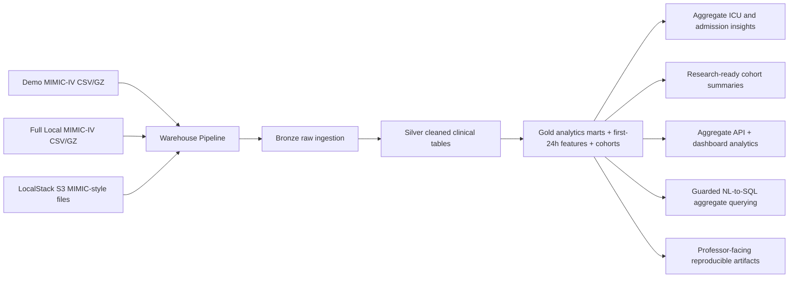
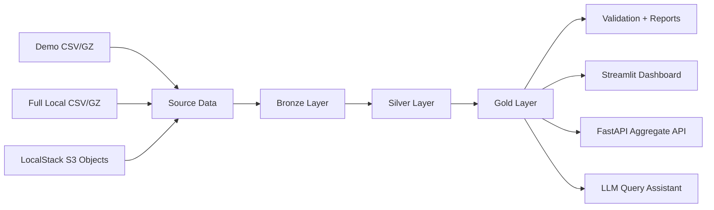
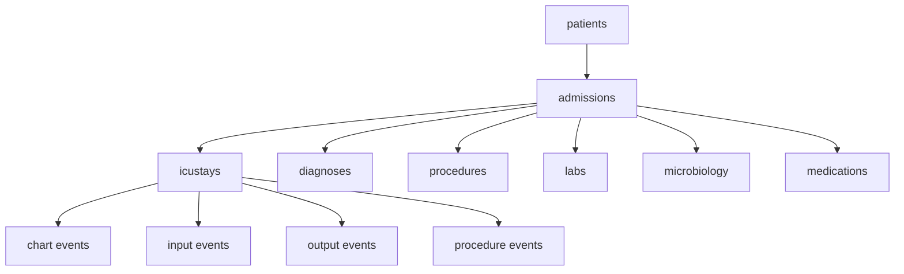
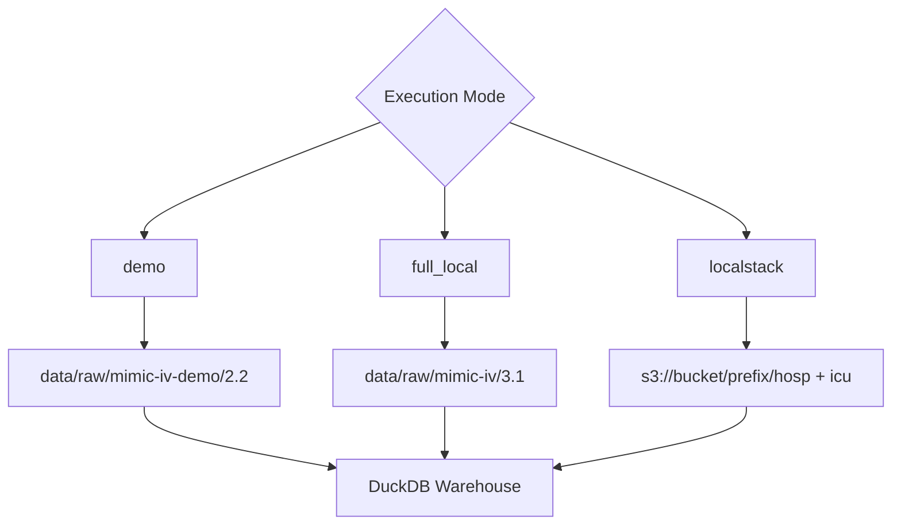
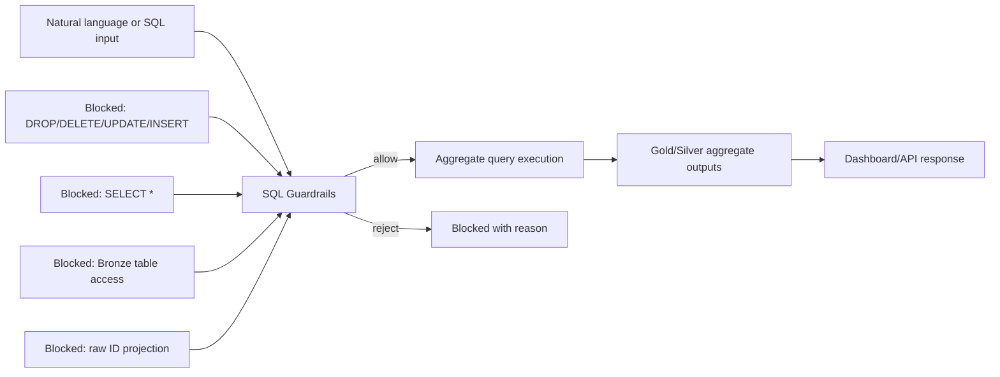

# MIMIC-IV Clinical Data Warehouse

**A Reproducible Clinical Data Warehouse and Query Intelligence Layer for ICU EHR Analytics using MIMIC-IV**

This project builds a reproducible clinical data warehouse and analytics layer using MIMIC-IV structured EHR data. The system supports demo-mode execution using the openly accessible MIMIC-IV demo dataset and full-mode execution for credentialed PhysioNet users. It ingests hospital and ICU modules, transforms raw tables into Bronze, Silver, and Gold warehouse layers, and produces patient-, admission-, and ICU-stay-level analytical marts. The project includes cohort construction templates, first-24-hour clinical feature engineering, aggregate dashboards, validation checks, and an optional schema-grounded LLM query assistant with privacy-preserving SQL guardrails. The goal is to demonstrate responsible clinical data engineering and reproducible EHR analytics for biomedical informatics and healthcare AI research.

> This repository does not contain MIMIC-IV data. Users must obtain access through PhysioNet and comply with the applicable Data Use Agreement. Demo mode uses the openly accessible MIMIC-IV demo dataset.

This is a research engineering project, not a clinical decision support system. It must not be used to diagnose, treat, or guide patient care.

## Architecture



## Input to Meaningful Output



## Project Diagrams

### 1) End-to-End Pipeline



### 2) Core Clinical Data Model



### 3) Execution Modes



### 4) Safety and Guardrails



## Dataset Access

The default configuration targets the MIMIC-IV Clinical Database Demo folder structure:

```text
data/raw/mimic-iv-demo/2.2/hosp/
data/raw/mimic-iv-demo/2.2/icu/
```

Full MIMIC-IV access requires PhysioNet credentialing, a signed Data Use Agreement, and required training. Place credentialed local files under:

```text
data/raw/mimic-iv/3.1/hosp/
data/raw/mimic-iv/3.1/icu/
```

BigQuery execution is intentionally out of scope for this public portfolio build. A metadata-only scaffold is kept in `configs/bigquery.yaml.example` for future credentialed extension, and credentials are never stored in the repository.

If you use LocalStack, see `configs/localstack.s3.yaml.example` for an S3-backed execution mode.

## Execution Map

Detailed execution responsibilities and the prioritized roadmap are documented in `AGENTS.md`.
PRD closure status is documented in `docs/09_prd_completion_checklist.md`.

## Setup

```bash
make setup
```

Then download the MIMIC-IV demo from PhysioNet and place its `hosp/` and `icu/` directories under `data/raw/mimic-iv-demo/2.2/`.

For a public-safe local demo without any MIMIC-IV files, generate synthetic CSVs:

```bash
make seed-synthetic
make run-all
```

The synthetic seed writes fake records into the ignored `data/raw/` directory. It is useful for testing the pipeline and dashboard, but it is not MIMIC-IV and should not be used for clinical analysis.

## Pipeline Commands

```bash
make seed-synthetic
make localstack-check
make ingest-demo
make ingest-localstack
make build-bronze
make build-silver
make build-gold
make validate
make profile
make run-all
make run-localstack
make llm-eval
make ml-baseline
make demo-pack
make precommit-install
make precommit-run
```

The pipeline is tolerant of missing optional demo files. If no raw files are present, it creates empty typed warehouse tables and private warning reports so the repo can still be smoke-tested without exposing data.

For local parity with GitHub Actions, run:

```bash
make ci
```

This command performs setup, synthetic seeding, end-to-end pipeline build, tests, and LLM guardrail demo checks.

`make demo-pack` generates a reviewer-ready synthetic outreach bundle in `outputs/public/`.

## LocalStack S3 Mode

This is the cloud-style execution path used in this repository. It ingests MIMIC-style CSV objects from LocalStack S3 and runs the same Bronze/Silver/Gold pipeline.

Steps:

1. Start LocalStack and create a bucket (example: `mimic`).
2. Upload files using the expected folder structure:
   - `s3://mimic/mimic-iv-demo/2.2/hosp/*.csv[.gz]`
   - `s3://mimic/mimic-iv-demo/2.2/icu/*.csv[.gz]`
3. Adjust `configs/localstack.s3.yaml.example` if endpoint/bucket/prefix differ.
4. Run:

```bash
make localstack-check
make ingest-localstack
make run-localstack
```

`make localstack-check` writes `outputs/private/localstack_readiness_report.md` so you can verify file coverage before ingestion.

## Dashboard

```bash
make dashboard
```

The dashboard shows aggregate counts, distributions, cohort sizes, and feature completeness. It does not display patient-level rows or raw identifiers by default.

## API

```bash
make api
```

Available local endpoints include:

```text
GET /health
GET /analytics/overview
GET /analytics/admissions
GET /analytics/icu
GET /analytics/labs
GET /cohorts
GET /cohorts/{cohort_name}/summary
POST /query/aggregate
```

The API rejects unsafe SQL and does not expose patient-, admission-, or stay-level lookup endpoints.

## Data Model

The project follows a Bronze/Silver/Gold structure:

- `bronze_*`: raw MIMIC-IV CSV/GZ tables with ingestion metadata.
- `silver_*`: cleaned patients, admissions, ICU stays, diagnoses, procedures, labs, microbiology, medications, orders, and ICU event tables.
- `gold_*`: analytics-ready patient, admission, ICU, first-24-hour feature, lab, vital, medication, diagnosis, and mortality baseline marts.

Core relationships:

```text
patients -> admissions -> icustays
admissions -> diagnoses/procedures/labs/microbiology/medications
icustays -> chart/input/output/procedure events
```

## Example Aggregate Questions

- How many patients, admissions, and ICU stays are available?
- What is the average ICU length of stay by care unit?
- What are the most common admission types?
- What percentage of ICU stays have lactate measured in the first 24 hours?
- What are the aggregate characteristics of the adult first ICU stay cohort?

## LLM Query Assistant

The optional query assistant is schema-grounded and aggregate-only. It rejects destructive SQL, `SELECT *`, Bronze table access, raw identifier projection, and non-aggregate patient-level queries. Generated SQL logs are written only to `outputs/private/`.

## Compliance

Public-safe outputs include code, SQL templates, diagrams, synthetic examples, documentation, aggregate statistics, and demo/synthetic screenshots. Do not commit raw MIMIC-IV rows, subject IDs, admission IDs, stay IDs, event-level exports, patient-level screenshots, credentials, or generated examples copied from real records.

## Collaboration Hygiene

This repository includes:

- pull request template: `.github/pull_request_template.md`
- issue templates: `.github/ISSUE_TEMPLATE/*`
- local pre-commit checks: `.pre-commit-config.yaml`

Install and run hooks:

```bash
make precommit-install
make precommit-run
```

## Limitations

MIMIC-IV is deidentified but restricted. It is single-center, temporally shifted, and not necessarily representative of all hospitals or patient populations. The demo dataset is intentionally small and not suitable for clinical conclusions. Any ML baseline in this repository is for demonstration only.

## Citations

- MIMIC-IV Clinical Database, PhysioNet.
- MIMIC-IV Clinical Database Demo, PhysioNet.
- MIMIC-IV documentation for Hosp and ICU modules.

## Professor-Facing Summary

This repository demonstrates production-style clinical data engineering around a real EHR research database: reproducible ingestion, schema-aware transformations, cohort definitions, first-24-hour clinical features, validation, aggregate dashboards, and privacy-preserving natural-language query guardrails. It is designed to be safe to review publicly while remaining useful for credentialed full-dataset research.
