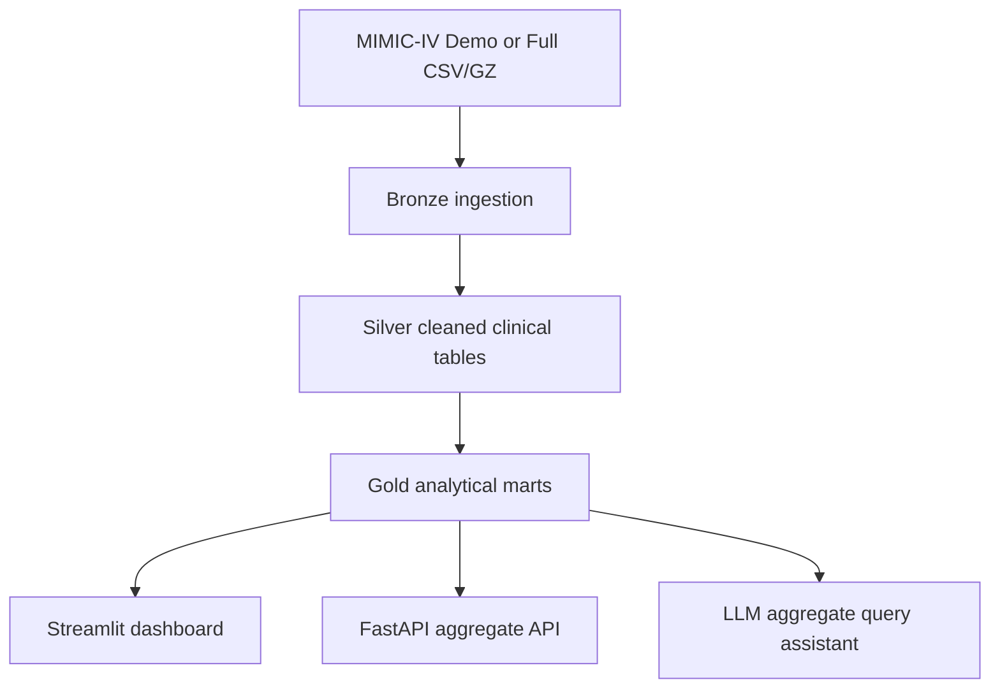

# Architecture

The warehouse uses a local DuckDB-first architecture with optional BigQuery metadata support.



## Bronze

Bronze tables preserve source columns after lower snake-case normalization and add ingestion metadata: `source_file`, `loaded_at`, `source_module`, and `pipeline_run_id`.

## Silver

Silver tables normalize types, keys, date fields, length-of-stay measures, dictionary labels, and first ICU stay markers.

## Gold

Gold tables create patient-, admission-, ICU-stay-, first-24-hour feature-, lab-, vital-, diagnosis-, medication-, and mortality baseline marts.

## Execution

Use:

```bash
make run-all
```

The same commands can be executed stepwise with `make ingest-demo`, `make build-silver`, `make build-gold`, and `make validate`.
