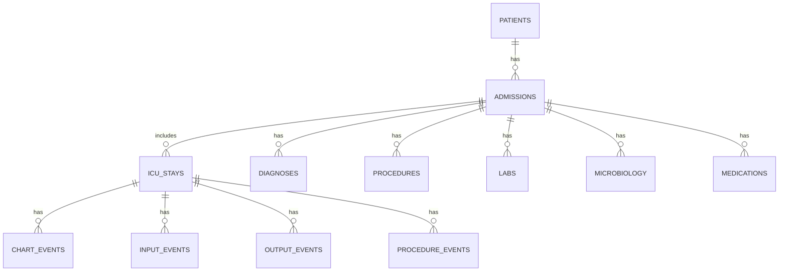

# Data Model

Core relationships:

## Core Tables

- `silver_patients`: one row per subject.
- `silver_admissions`: one row per hospital admission.
- `silver_icustays`: one row per ICU stay.
- `silver_labs`: lab events joined to lab dictionary labels.
- `silver_chart_events`: ICU chart events joined to item labels.

## Gold Marts

- `gold_patient_summary`: patient-level aggregate history.
- `gold_admission_summary`: admission-level utilization and outcome summary.
- `gold_icu_stay_summary`: ICU-stay-level summary.
- `gold_first_24h_features`: pre-outcome feature window for ICU stays.
