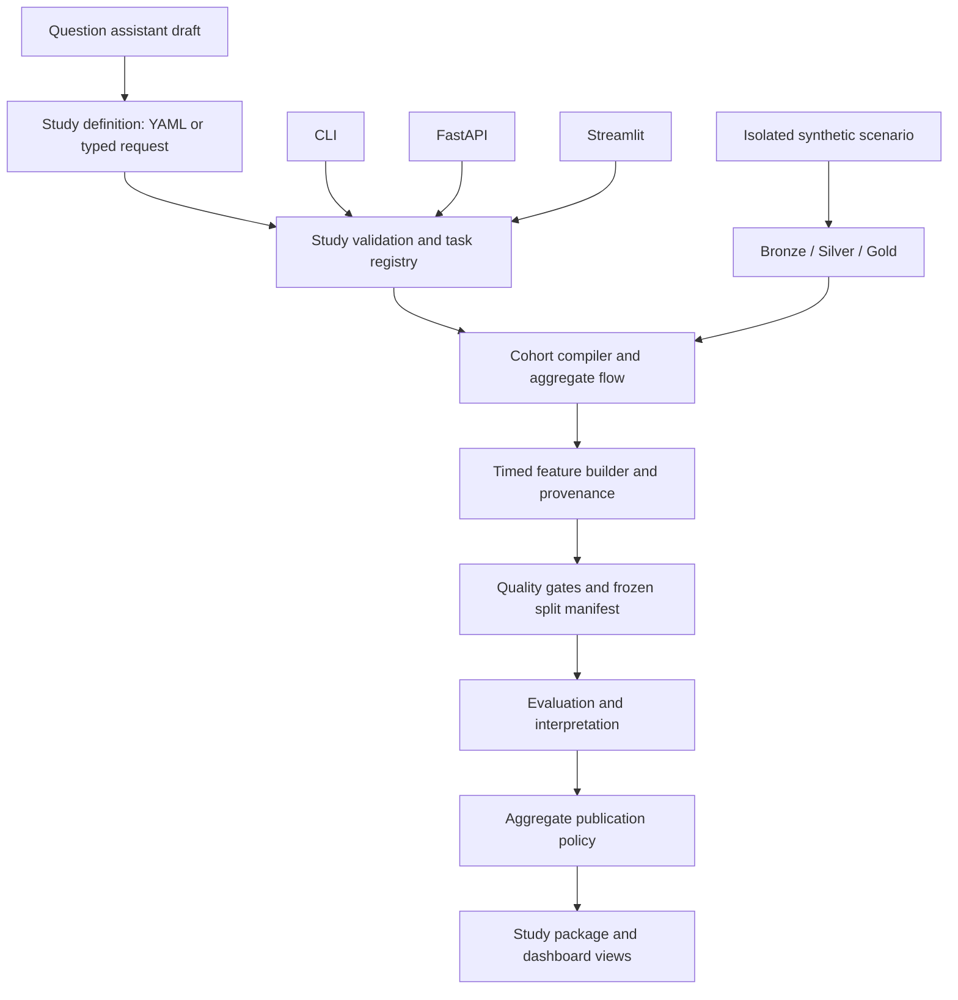

# Trustworthy Clinical Research Platform: Implementation Blueprint

Date: 2026-10-17

Status: **Implemented locally for the invented synthetic research path on 2026-10-17.** The implementation is intentionally limited to the supported ICU mortality study and synthetic scenarios described in the repository; real-data research remains outside this build.

Audience: project maintainers, research collaborators, and reviewers of the synthetic research demonstration.

This document records how the implemented synthetic research extension fits into the existing warehouse. It specifies the shared architecture, methodological corrections, module boundaries, data contracts, verification requirements, and presentation workflow. It is not evidence of clinical validity or a claim about real MIMIC-IV data.

### Implementation boundary

The checked-in implementation covers one fixed, versioned ICU mortality study
on invented synthetic data. It includes contracts, cohort flow, a restricted
cohort builder, timed feature construction, quality gates, bootstrap intervals,
signed linear attributions, aggregate package checksums, dashboard pages, API
routes, an assistant draft endpoint with a versioned corpus, and a two-site
synthetic transferability demonstration with separate recalibration. Sections
that describe job queues, generic phenotype filters, broad free-form studies,
or production deployment requirements remain
design requirements for later work. They are retained so future changes have a
clear target, not because those facilities are present now.

## 1. Purpose and research question

Evolve the warehouse into a reproducible environment for studying this question:

> How do data quality, measurement availability, and differences between simulated hospitals affect cohort construction and ICU prediction experiments?

The demonstration should make the chain from a research question to its evidence inspectable: question → study definition → cohort → observations available at the prediction time → model evaluation → aggregate study package.

The intended audience includes Dr. Abu Saleh Mohammad Mosa. UAB's [faculty profile](https://www.uab.edu/medicine/informatics/faculty) lists interests in predictive modeling, LLMs, research computing infrastructure, and clinical research information systems. His work on [secondary use of clinical data](https://pubmed.ncbi.nlm.nih.gov/26821445/) discusses cohort identification and research repositories. The design choices below are our interpretation of that alignment; they do not imply his endorsement or institutional affiliation with this project.

Success means an observer can reproduce a study, understand each inclusion/exclusion, inspect the timing of every model input, and see how controlled errors change the result. Synthetic prediction scores establish software behavior only.

## 2. Current implementation and integration points

The following describes the inspected worktree, not an idealized architecture.

| Existing component | Current behavior | Integration decision |
| --- | --- | --- |
| `src/cli.py`, `Makefile` | Ingestion, layered builds, validation, reporting, `research-demo`, and study orchestration | Retain existing warehouse commands; study commands use the isolated invented-data configuration |
| `src/ingest/load_demo.py`, `load_full_local.py`, `load_localstack_s3.py` | Load source-shaped files into Bronze | Reuse loaders; give each experiment an explicit dataset manifest and isolated workspace |
| `sql/bronze/`, `sql/silver/`, `src/transform/run_sql_layer.py` | Preserve raw-like inputs, standardize entities and events | Retain descriptive data; preserve event availability timestamps and unit information needed for research |
| `sql/gold/` | Descriptive marts and first-24-hour ICU summaries | Retain descriptive marts; add explicitly timed research feature construction |
| `sql/research/gold_research_index_admissions.sql` | One index hospital admission per patient, with optional first ICU stay | Keep as a legacy workshop path until migrated; introduce an explicit ICU study grain for the new flagship demonstration |
| `configs/research/`, `src/research/config.py` | Feature names, sources, availability text, exclusions, and some plausibility ranges | Extend to executable task-specific feature contracts with versions |
| `src/research/evaluate.py` | Legacy workshop model comparison and aggregate artifacts | The flagship timed study uses `study_service.py`, task contracts, and interpretation services |
| `dashboard/pages/5_Cohorts.py`, `dashboard/components/queries.py` | Fixed cohort templates and direct aggregate queries | Keep legacy templates; add a builder backed by the shared study service |
| `src/api/routes_cohorts.py` | List fixed cohort templates and return summaries | Add a separate `/studies` API namespace to avoid breaking existing routes |
| `src/llm/nl_to_sql.py` | Deterministic keyword/template matching | Unmatched questions are explicitly unsupported; study requests are drafted through typed contracts |
| `src/validation/` | Schema, key, date, and row-count checks | Reuse `ValidationResult`; add temporal, task, scenario, and publication checks |
| `src/reporting/` | Pipeline, dictionary, professor-facing reports | Add a manifest-driven study package exporter |
| `.github/workflows/ci.yml` | `make ci` on Python 3.11/3.12 | Run the deterministic flagship study in addition to existing fixtures; keep site experiments optional |

The dashboard and API currently open the configured DuckDB database directly. The proposal makes new study logic a shared Python service, callable from either interface, rather than maintaining two implementations of cohort rules.

## 3. Release gate: correct the research foundation first

These issues must be resolved before the enhanced demonstration is described as methodologically ready. Existing passing tests do not establish these properties.

| Current issue | Required correction | Proof required |
| --- | --- | --- |
| Research predictors include `gold_lab_features` summaries over the entire ICU stay, despite a 24-hour prediction time | Build separate timed research lab summaries; do not relabel whole-stay summaries as first-24-hour inputs | A lab after the cutoff can alter descriptive marts but cannot alter predictors |
| Chart/lab feature construction primarily uses event time, without a complete result-availability policy | Preserve available/store timestamps; define event-time and availability-time predicates; exclude unknown availability by default for prospective prediction | A sample collected before the cutoff but released after it is absent from the model input |
| Diagnosis/procedure codes have no reliable prospective availability in current tables | Treat current-admission discharge coding as retrospective phenotype metadata; exclude from prospective tasks unless an independently timestamped source establishes availability | Task registry rejects unproven diagnosis/procedure predictors |
| Disease classification uses diagnosis flags derived from the target's codes | Remove the circular model from the flagship prospective study; retain diagnosis classes only for retrospective cohort descriptions or create an independently defined future task | Target-source dependency checks reject direct and derived target proxies |
| `_linear_attributions` takes absolute coefficients and labels them contributions | Preserve signed coefficients and class labels; compute actual baseline-centered contributions or use a documented SHAP implementation | Reconstruction/additivity checks match model output on the stated output scale |
| A common predictor list is used for all targets | Create per-task allowlists and exclusions, including proxy dependencies | Each task exports its exact feature set and exclusion reasons |
| The 73-name catalog contains potentially constant, redundant, or empty features; min/max may reflect a single measurement | Profile on training data; identify unsupported, constant, sparse, and redundant features; record any removal | A feature audit distinguishes catalog size from active model input count |
| Current readmission labels use absence of a later recorded admission as a negative | Declare ascertainment limitations; introduce explicit observable follow-up/censoring in synthetic data | A survivor with incomplete follow-up receives an unknown label, not a negative |
| Repeated CV is performed after model selection on the same development data | Label it descriptive stability analysis, or use nested CV for an unbiased selection estimate; preserve a locked final test set | Reports state selection data, evaluation data, and estimand clearly |

Do not preserve a target feature count at the expense of trustworthy inputs. The catalog can contain 73 documented candidates while individual tasks use smaller justified subsets.

## 4. Shared architecture



### Shared ownership

| Implemented module | Responsibility | Must not own |
| --- | --- | --- |
| `src/research/contracts.py` | Typed study, feature, scenario, result, and manifest schemas | Database execution |
| `src/research/study_service.py` | Validate → plan → run → publish orchestration | UI state or free-form generated code execution |
| `src/research/cohorts.py` | Validate cohort operators; compile parameterized SQL; produce cumulative flow | Model fitting |
| `src/research/timing.py` | Prediction anchors, event availability, temporal eligibility | Clinical phenotype claims |
| `src/research/features.py` | Build feature frames and provenance from the feature registry | Dataset splitting or target selection by score |
| `src/research/tasks.py` | Target definitions, ascertainment, task-specific predictor eligibility | Presentation styling |
| `src/research/study_service.py` | Deterministic patient split, development CV, evaluation, and run manifest | Changing partitions after viewing results |
| `src/research/interpretation.py` | Signed coefficients, legitimate contribution calculations, aggregate exports | Causal claims |
| `src/research/scenarios.py` | Deterministic synthetic perturbation and simulated-site generation | Mutating existing user datasets |
| `src/research/publication.py` | Validate aggregate release schema and apply suppression policy | Claiming aggregate output alone guarantees privacy |
| `src/research/publication.py` | Export allowlisted artifacts and verify checksums | Recursive copying of raw/private output folders |

The shared service accepts a resolved `WarehouseConfig` plus a validated study specification; UI and API adapters do not build cohort SQL themselves. The currently supported scope is one versioned synthetic ICU mortality study. The broader builder described later remains a roadmap item.

### Run lifecycle and database access

Use `draft → validated → running → succeeded | failed → published`. Publication is a distinct state and requires all blocking gates to pass. A failed run preserves private diagnostics and cannot publish a success package.

Use one writer per experiment workspace. Start with synchronous local CLI execution and a single local API worker; reject a second writer with a structured conflict response. Long-running API execution should use an explicit job adapter only when implemented, with persisted status and restart recovery. Streamlit reads completed snapshots rather than rebuilding tables on each rerun.

Add a true read-only connection option in `src/core/db.py` for published snapshots. Snapshot identity must be part of dashboard cache keys. A new snapshot invalidates cached cohort results.

## 5. Common data and configuration contracts

### Study definition

Implemented file: `configs/studies/icu_mortality_24h.yaml`.

```yaml
schema_version: 1
study_id: icu_mortality_24h_v1
question: How does delayed lab availability affect a synthetic ICU mortality study?
dataset:
  manifest: outputs/private/studies/datasets/synthetic_v1/manifest.json
  required_origin: synthetic_invented
cohort:
  grain: icu_stay
  minimum_age: 18
  first_stay: first_icu_per_patient
  require_alive_at_prediction: true
  require_in_icu_at_prediction: true
prediction:
  anchor: icu_intime
  horizon_hours: 24
  event_window: half_open
  require_available_by_prediction: true
  unknown_availability: exclude
task:
  name: death_after_prediction_before_hospital_discharge
  version: 1
features:
  registry_version: 2
  set: prospective_icu_24h_v1
evaluation:
  split_unit: patient
  seed: 42
  proportions: [0.70, 0.15, 0.15]
  cv: {folds: 3, repeats: 2, purpose: development_stability}
publication:
  aggregate_only: true
  minimum_cell_count: 10
```

This configuration is runnable through the CLI, API, and dashboard. The service validates the supported fields, task version, feature registry version and set, synthetic origin, prediction horizon, and evaluation split. API callers choose a server-resolved study name; they cannot provide a filesystem path. The current narrow contract deliberately rejects unsupported values rather than offering an unbounded builder.

### Identity and reproducibility

- `dataset_id`: immutable manifest identifying input origin, generator/version/seed, source coverage, and a content fingerprint. For restricted sources, keep detailed source fingerprints private.
- `study_definition_hash`: hash of canonical configuration, registry versions, and relevant SQL definitions. Display this with results.
- `run_id`: unique execution identity; never reuse a prior run directory for a new execution.
- `code_revision`: Git revision plus dirty-worktree flag and hashes or a local patch for relevant modified/untracked code. A commit alone cannot identify this project's current uncommitted implementation.
- `split_manifest_hash`: identifies a private patient-to-partition assignment tied to dataset identity. Public packages contain counts and a permitted fingerprint, not patient assignments.
- `artifact_schema_version`: version of each exported result contract. Record environment/dependency versions and numerical tolerances for comparisons.

### Feature registry

Extend `configs/research/feature_definitions.yaml` with `version`, `unit`, `source_tables`, `source_columns`, `derivation_id`, `grain`, `event_time_column`, `available_time_column`, `window_anchor`, `window_hours`, `availability_evidence`, `missingness_policy`, `allowed_tasks`, and `target_dependencies`.

The executable SQL implementation of each `derivation_id` is registered in code. The registry is not a place to accept arbitrary expressions from a browser. Version changes must invalidate old feature caches and appear in run manifests.

Every numeric candidate needs a unit-specific check or an explicit documented exemption. A synthetic value exceeding 100% oxygen saturation should be a failed input scenario, not accommodated by silently widening the normal range.

## 6. Improvement A: interactive cohort builder

### Behavior

Extend the existing Cohorts page with a study-builder mode. Support age, first ICU stay definition, care unit, prediction-window eligibility, and a limited registry of retrospective phenotype filters. Distinguish selecting a retrospective phenotype from using that phenotype as a prospective predictor.

Show the definition in plain language, the compiled SQL, and an ordered cumulative inclusion flow. Define the first-stay rule precisely: selecting the first-ever ICU stay and then filtering differs from selecting the first eligible stay. The initial release uses first-ever ICU stay per patient, with ties resolved by `intime`, then `stay_id`.

Return counts of patients, admissions, and ICU stays at every step. Count each unit distinctly after reducing event tables to the selected grain. Add visible exclusions for missing anchors, unavailable age, early discharge, death before prediction, and absent required source coverage. If an optional source is missing, report `unsupported` rather than showing a misleading zero-event cohort.

### API and service contract

Proposed routes:

- `POST /studies/validate`: typed definition → normalized definition, errors, warnings, capability requirements.
- `POST /studies/preview`: validated definition → definition hash, compiled aggregate SQL, ordered flow, exclusion summaries; no model fitting.
- `POST /studies/run`: definition hash plus expected dataset snapshot → run identifier and terminal result for initial synchronous local execution.
- `GET /studies/runs/{run_id}`: status, aggregate result references, gate outcomes; private filesystem paths omitted.

The server stores the reviewed normalized plan. A snapshot or definition change between preview and execution requires revalidation. `400/422` identifies invalid input, `404` an unknown run, and `409` a stale snapshot or active writer. Validation failures are machine-readable records with `code`, `field`, and `message`.

### Acceptance evidence

A fixed fixture has independently calculated flow counts; every step is monotone for the selected population; ties and first-ever-vs-first-eligible behavior are covered. Adding multiple lab records must not multiply cohort rows. CLI, API, and dashboard service calls produce identical plan hashes and aggregates for the same snapshot.

## 7. Improvement B: feature timing and leakage explorer

### Temporal contract

For ICU anchor `t0`, prediction time `tp = t0 + 24 hours`:

- Measurement event time is in `[t0, tp)`.
- Result availability time is `<= tp`; availability before the event is an error.
- The patient is alive and in the ICU at `tp` for the flagship task; ties at death/discharge boundaries are explicitly excluded and counted.
- A death target is strictly after `tp` and before or at hospital discharge. Deaths before prediction are exclusions, not positive examples available to the model.
- Inputs without known prospective availability are excluded by default; sensitivity experiments may deliberately relax the policy and label that change.

Define first-24-hour labs in a dedicated research query using the same event and availability predicates as charts and interventions. Keep whole-stay descriptive marts separate from prediction inputs. Preserve `storetime` in the needed Silver schemas; record whenever it is a proxy for clinical availability rather than a proven timestamp.

### Explorer interaction

For each feature show definition, units, data lineage, allowed tasks, excluded-event counts by reason, null rate, measurement count, and timing-policy version. Public views display aggregate timing histograms and a deliberately invented illustration. They never reveal a restricted patient's timeline.

Add a mutation demonstration: inject one event after the cutoff and one event collected before the cutoff but available afterward. The explorer shows both exclusions and verifies unchanged feature-frame and evaluation fingerprints. An eligible event injected within both boundaries should change the expected feature only.

### Acceptance evidence

Cover cutoff equality, unknown timestamps, delayed results, pre-anchor intervention starts, duplicate events, and death/discharge before prediction. The target-code dependency test must reject both a direct diagnosis flag and a composite count containing that flag for disease classification.

## 8. Improvement C: data quality impact laboratory

### Execution model

Create an isolated copy of an invented dataset under `outputs/private/studies/scenarios/{scenario_id}/`, with separate source files, DuckDB database, and output folders. The scenario runner must verify synthetic origin from the dataset manifest, resolve canonical paths, reject symlinks escaping the workspace, and refuse mutations against credentialed/full-local data or the baseline dataset.

Register deterministic scenarios in `configs/research/scenarios.yaml`:

| Scenario | Controlled mutation | Expected evidence |
| --- | --- | --- |
| Duplicate admission | Duplicate a known fraction of admission keys | Key check fails; downstream evaluation is blocked |
| Missing ICU anchor | Remove selected `intime` values | Explicit exclusions; cohort delta matches affected eligible stays |
| Impossible vital | Insert impossible saturation or negative physiological values | Unit/range check fails; no silent clipping |
| Delayed laboratory result | Move availability beyond prediction time | Timed completeness falls; affected features become missing |
| Missingness shift | Remove measurements under a declared synthetic mechanism | Completeness and evaluation metrics reported with uncertainty |
| Future leakage challenge | Insert strongly target-correlated events after prediction | Descriptive summaries may change; prospective features cannot change |

Never bypass a blocking quality failure to publish a model score. For such scenarios display `blocked_by_quality`, affected-row counts, and the detected issue. Valid scenarios can compare model metrics.

### Comparison protocol

Freeze the baseline patient partition and keep the primary model frozen when measuring input disruption. Report paired comparisons for eligible patients common to both runs, alongside a separate attrition analysis. A separately labeled retraining experiment may answer how well a model adapts; it must not be mixed with frozen-model effects.

Export baseline/scenario counts, missingness changes, gate results, metric differences, and bootstrap intervals where estimable. Bootstrap patients rather than individual events. Report `not_estimable` with a reason for one-class or empty subsets. Use validated, allowlisted scenario names and bounded mutation rates.

### Acceptance evidence

Baseline hashes remain unchanged; repeated scenario seeds produce the same mutations; invalid rates/paths/origins are rejected; every controlled failure triggers the specified gate. Changes in cohort composition are visible rather than hidden by reporting only retained rows.

## 9. Improvement D: auditable research question assistant

### Integration

Keep a deterministic offline path. Add an optional model adapter only after the typed workflow and evaluation corpus exist. The assistant drafts a `StudySpec`; the cohort compiler produces SQL. The model never supplies executable Python, file paths, credentials, or arbitrary SQL to the study executor.

Replace `generate_sql`'s unmatched-question fallback with `unsupported`. Define response states: `draft`, `needs_clarification`, `unsupported`, `rejected`, `ready`. “Mortality among ICU patients” needs an explicit mortality definition, grain, and observation/prediction time before execution. “Sepsis” must resolve to a named retrospective proxy or an explicitly specified phenotype, not silently assume a validated definition.

Proposed route: `POST /studies/assistant/draft`, returning interpretation, unresolved fields, proposed definition, source references to the local schema/registry, and confidence only if it has a defined meaning. Require a reviewed plan identity before calling the normal run service.

Keep generated aggregate SQL subject to existing guardrails, plus semantic plan validation and server-owned table/operator allowlists. Existing SQL-pattern checks are defense in depth, not proof of semantic correctness. Record private prompt/plan history and publish only approved structured summaries.

### Evaluation

Build a versioned corpus of supported, ambiguous, unsupported, adversarial, and clinically overloaded questions. Compare normalized plans and aggregate results against manually reviewed references. Measure correct interpretation, appropriate clarification/refusal, execution correctness, and unsafe-request handling. A safely executed answer to the wrong question is a failure.

No external provider receives row-level data. If an external model is later enabled, send only approved schema descriptions and the user's question under an explicit configuration policy.

## 10. Improvement E: simulated hospital transferability study

### Synthetic site design

Extend `src/research/seed.py` with versioned scenario parameters for patient mix, outcome prevalence, measurement frequency, event availability delay, coding coverage, and units. Generate multiple measurements within and beyond the prediction window so min/max/trend features have meaningful support. Store generator truth separately from observed source-like events; latent severity must never become a predictor.

Create site A and site B with globally distinct invented patient identifiers and explicit `site_id`. Site identity is metadata for partitions and reporting, excluded from the initial model. Hold the outcome mechanism fixed in one experiment while changing measurement practices; vary patient mix in another. Do not simultaneously change every parameter and attribute the result to one cause.

### Evaluation protocol

1. Split site A patients into training, validation, and locked test partitions.
2. Fit imputation, scaling, encoders, feature selection, and model parameters using site A training data only.
3. Choose model and thresholds on site A validation data.
4. Evaluate once on locked site A test and untouched site B test patients.
5. Report AUROC/AUPRC, prevalence, Brier score, calibration, chosen-threshold sensitivity/specificity, sample size, and uncertainty for binary targets; MAE/RMSE and residual summaries for LOS.
6. For recalibration, reserve a distinct site B calibration partition. Evaluate the recalibrated model on a still untouched B test partition; include the original model comparison.

Patient groups stay disjoint across sites, folds, calibration, and test partitions. On repeated classification CV use stratified patient grouping where feasible and declare insufficient classes explicitly. CV of a previously chosen model measures stability; use nested selection if claiming unbiased cross-validated model selection performance.

### Interpretation and limits

Demonstrate measurement shift, calibration changes, and the conditions under which performance worsens or remains stable. Do not require a scenario to produce a particular direction of change. This is a controlled simulation of transferability mechanisms, not external clinical validation or evidence of transportability to an actual hospital.

### Acceptance evidence

No patient overlap; preprocessing never fits on B test data; injected delay/missingness is reflected in observed features; the generator seed/configuration is recorded. Class-deficient sites produce an honest unavailable metric rather than a fabricated zero.

## 11. Improvement F: reproducible study package

### Output contract

Use `outputs/private/studies/{run_id}/` for work products and `outputs/public/studies/{run_id}/` for explicit publication. Restricted runs require an explicit release policy; a directory name or `public_mode` flag alone does not authorize export.

```text
public study package/
  README.md                         # question, origin, limits, how to reproduce
  study_definition.yaml             # normalized, sanitized definition
  manifest.json                     # versions, identities, environment, status
  cohort_flow.csv                   # aggregate cumulative counts
  feature_dictionary.csv            # active/inactive inputs and reasons
  feature_timing_audit.csv           # aggregate exclusions and coverage
  quality_summary.json              # gate status and aggregate issues
  model_comparison.csv
  evaluation_summary.json           # metrics, denominators, uncertainty
  interpretation/                   # signed coefficients or verified attributions
  charts/                           # aggregate figures
  checksums.sha256                  # files other than this checksum file
```

No database files, raw records, patient assignments, per-patient predictions, credentials, private prompts, or private paths belong in the public package. Export an explicit schema/file allowlist; validate cell values as well as column names. Do not recursively copy an output tree.

For restricted-source aggregates, apply policy-configured minimum cell counts, complementary suppression where totals would reveal a suppressed cell, and disclosure review appropriate to the data agreement. Repeated interactive queries can permit differencing; unrestricted public query access to restricted data is outside this local demonstration. Synthetic demonstrations can show small counts while preserving a clear origin label.

Build the package in a temporary directory and publish atomically only after validation. Verification detects a modified or missing artifact. Reproduction compares canonical aggregates and numeric tolerances rather than expecting byte-identical timestamps or rendered HTML. Capture a private dependency lock/environment snapshot; retain references to it in the package.

CSV is currently globally ignored by `.gitignore`; generated tables must be reproducible via commands or distributed in approved packages. Do not assume that locally generated CSVs are tracked. Add narrowly scoped exceptions only if deliberately publishing synthetic aggregate fixtures.

## 12. Implemented interfaces and UI fit

| Surface | Proposed change | Shared service |
| --- | --- | --- |
| New `7_Research_Study.py` | Fixed validated study definition, aggregate preview, execution, and package publication | `study_service` |
| New `8_Data_Quality_Lab.py` | Synthetic scenario selection and gate evidence | `scenarios`, validation services |
| Existing Query Assistant | Explicit unsupported response for unmatched aggregate questions | query guardrails |
| `POST /studies/assistant/draft` | Typed draft, clarification, or unsupported response; no execution | assistant adapter |
| `POST /studies/*` | Validation, preview, run, and aggregate package publication for registered study names | `study_service` |

Available CLI commands:

```bash
make study-validate
make study-preview
make study-run
make study-scenario                 # delayed availability scenario
make study-transferability          # invented site A to site B evaluation
python -m src.cli study-package --config configs/research_synthetic.duckdb.yaml --run-id <completed-run>
```

`make ci` runs the seed, warehouse pipeline, legacy research workshop, flagship study validation and run, tests, and LLM checks. Run the research dashboard with `MIMIC_CONFIG_PATH=configs/research_synthetic.duckdb.yaml` so it uses the research database rather than the default six-patient demo.

For the proposed API, impose input-size, feature-count, runtime, and output-row limits. Local unauthenticated operation must bind to loopback; shared deployment requires authentication, authorization, rate limits, and audit retention before handling restricted data.

## 13. Roadmap sequence and deliverables

| Phase | Scope and primary files | Completion gate |
| --- | --- | --- |
| 0: correctness | `evaluate.py`, research SQL, Silver timestamp preservation, feature/task registry, attribution correction | Future-event invariance, delayed-result exclusion, circular-target rejection, signed/additive interpretation checks |
| 1: shared study engine | New contracts/service/cohort/timing modules; immutable manifests; CLI preview/run | Independently verified cohort flow, frozen partitions, stale-plan rejection, isolated writer behavior |
| 2: visible research workflow | Cohort builder and feature timing pages; `/studies` routes | UI/API/CLI parity and end-to-end reviewed study execution |
| 3: quality laboratory | Scenario registry/runner; mutation fixtures; comparison reporter | Baseline immutability, expected gate failures, paired comparison and attrition accounting |
| 4: auditable assistant | Typed draft adapter; removal of unmatched fallback; evaluation corpus | Correct clarification, reference plan agreement, unsafe request rejection |
| 5: simulated sites | Generator parameters, site manifests, partition protocol, shift report | No site/test contamination; reproducible observed shifts; honest metric limitations |
| 6: study package | Publication schemas, allowlist exporter, verifier, presentation bundle | Artifact integrity, permitted content, reproducible canonical results |

For an early presentation milestone, complete phases 0–3 and a minimal package from phase 6. Add the assistant and simulated-site study after the correctness gates hold. Package metadata and identity contracts must be established in phase 1 even if the full exporter arrives later.

The declared warehouse scope remains distinct from this proposed research phase. Update `AGENTS.md` and completion checklists with evidence after each phase; do not mark the new phase complete based on old warehouse validation counts.

## 14. Verification strategy

Verification must test scientific invariants and interface behavior, not merely the presence of generated files.

| Check | Fixture/action | Required assertion |
| --- | --- | --- |
| Cohort semantics | Hand-built multi-admission/multi-stay data | Correct patient/admission/stay flow; deterministic first-ever stay |
| Event availability | Event before/at/after cutoff, late availability | Exact half-open window and known availability policy |
| Target timing | Early death/discharge and incomplete follow-up | Explicit exclusion/unknown labels; no prospective early outcomes |
| Leakage dependencies | Add target-derived direct/composite feature | Task compilation fails with dependency reason |
| Mutation invariance | Add unavailable future measurements | Feature values and frozen-model predictions remain unchanged |
| Split isolation | Repeat admissions; simulated sites | No patient crosses any applicable partition/fold boundary |
| Interpretation | Known small linear model | Signed coefficient preservation; baseline plus contributions reconstruct stated output |
| Quality failures | Duplicate key/impossible value scenario | Gate failure blocks evaluation/publication |
| Assistant semantics | Ambiguous and unmatched questions | Clarification/unsupported status; no unrelated executed default |
| Publication | Forbidden fields, tiny cells, modified files | Policy rejects or suppresses; checksum verification detects mutation |
| Interface parity | Same plan and dataset via CLI/API/service | Identical canonical definitions, cohort counts, and feature registry versions |
| Reproduction | Repeat a seeded study in a fresh workspace | Same cohort/split identities and aggregates within declared numerical tolerance |

Add focused fixtures to `tests/test_research_workshop.py` or new study-specific test modules as the relevant phases are implemented. Keep warehouse and API regression checks. Extend `make ci` with a small representative study; larger site experiments and sweeps should be separately runnable and report duration, environment, and peak resource use. No performance claim is accepted without a measured baseline.

## 15. Presentation workflow and claims

Suggested eight-minute walkthrough after the relevant phases pass:

1. **Question and provenance (one minute):** show the study question, invented-data origin, code/configuration identities, and what the experiment can establish.
2. **Cohort construction (two minutes):** change one criterion, show cumulative patient/stay counts and the saved plan.
3. **Temporal evidence (two minutes):** inspect a lab feature; inject future/delayed results; show exclusions and unchanged prospective predictions.
4. **Quality impact (one minute):** inject duplicate keys and show a blocked run; switch to a valid delayed-result scenario and show paired effects.
5. **Reproduction (two minutes):** export the aggregate package, verify it, and explain how a collaborator reruns the same definition.

When implemented, the simulated-site study can replace the quality scenario for a longer discussion. Explain uncertainty and cases where a scenario causes little change. Avoid presenting a high synthetic AUROC, a feature-count milestone, or a single passing test run as clinical validation.

Prepare a backup package and screenshots from a verified run. The live demonstration must display its active dataset and configuration, so a default database selection cannot silently change the presentation.

## 16. Completion checklist for the implemented synthetic phase

- [x] Foundation issues in section 3 corrected with semantic evidence: late availability is excluded and coding fields do not enter the prospective feature table.
- [x] Study, feature, task, scenario, and package contracts are versioned for the supported study.
- [x] One shared engine serves the CLI, API, and dashboard.
- [x] A restricted builder varies minimum age and care unit while retaining the reviewed first-stay, task, and timing rules.
- [x] Timing audit reports event/availability categories and boundary behavior is tested.
- [x] Isolated delayed-availability, missing-anchor, duplicate-key, and impossible-value scenarios run; blocking failures stop execution.
- [x] The assistant returns `draft`, `needs_clarification`, or `unsupported` without executing a study, and its reviewed corpus runs in CI.
- [x] The simulated-site experiment trains only on invented site A, evaluates unchanged preprocessing on invented site B, then separately recalibrates on a held-out site-B partition.
- [x] Attribution exports retain signed coefficients and verify linear additivity.
- [x] Aggregate packages use an explicit allowlist and SHA-256 verification.
- [x] The manifest records configuration, code revision, Python version, and dataset snapshot; test metrics include deterministic bootstrap intervals and CI exercises the flagship run.
- [ ] Presenter screenshots and a backup package should be regenerated from the final local run before a live review.

### Deliberately deferred scope

The implementation does not yet offer unrestricted cohort construction, job orchestration, paired frozen-model scenario comparison, phenotype libraries, or deployment controls for restricted data. Those are next iterations, and this document leaves their acceptance criteria intact as a roadmap rather than representing them as shipped functionality.

Real-MIMIC distribution learning, real-patient holdout privacy similarity, and claims of real-hospital predictive validity remain outside the synthetic demonstration. They require separately authorized data and a suitable study protocol.
